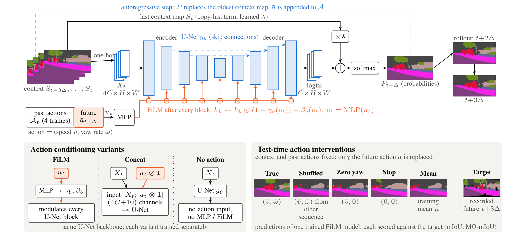
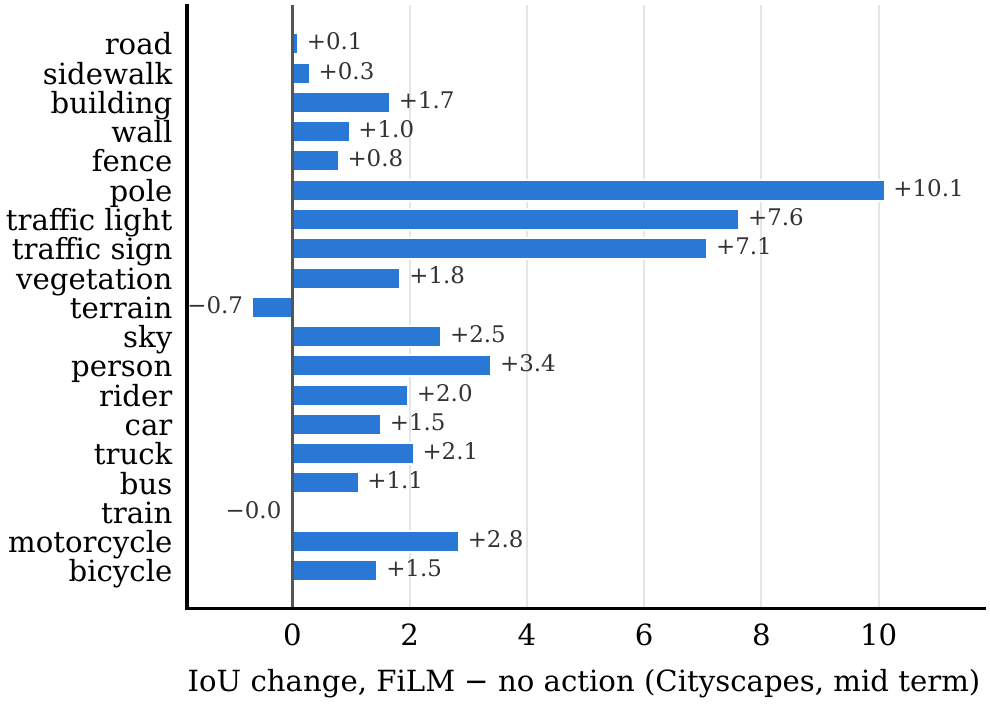
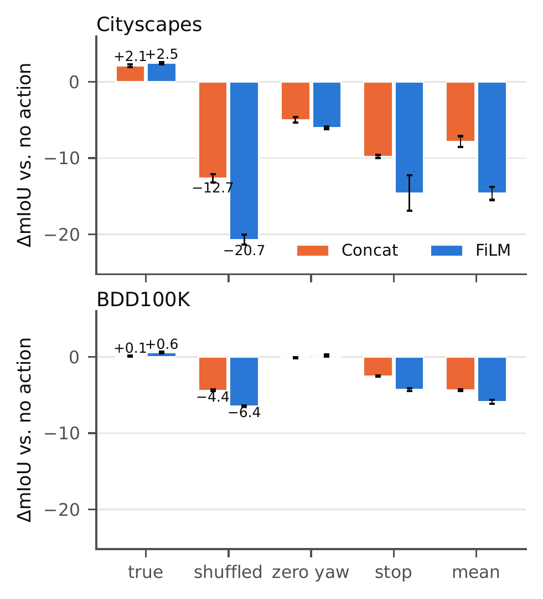

# Does the Action Matter? Probing Action-Conditioned Semantic Forecasting as a World Model for Autonomous Driving

Code for the WAM-AD Workshop paper at WACV 2027.

Action-conditioned world models are expected to predict how a driving scene evolves
under the ego vehicle's action. This repository measures how strongly such a model
depends on its action: a semantic forecaster is trained with feature-wise (FiLM),
input-level (concat) or no action conditioning, and evaluated with test-time action
interventions (shuffled, zero yaw, stop, mean action) scored by standard
segmentation metrics (mIoU, MO-mIoU). The interventions are validated in a
synthetic environment and applied to Cityscapes and BDD100K.



*Top: the forecaster. A U-Net predicts the next semantic segmentation from four
context segmentations and the ego action (speed, yaw rate), with a learned
copy-last term; mid-term forecasts are rolled out autoregressively. Bottom left:
the three action-conditioning variants. Bottom right: the test-time action
interventions, shown as predictions of one trained FiLM model during a left turn.*

## Results

**Forecasting accuracy with the executed action** (mIoU / MO-mIoU in %, mean ± std
over three seeds; models trained and evaluated on the same dataset; BDD100K is
scored against SegFormer-B5 pseudo-labels):

| Method | Cityscapes short | Cityscapes mid | BDD100K short | BDD100K mid |
|---|---|---|---|---|
| Copy-last | 55.77 / 52.51 | 40.82 / 32.62 | 49.06 / 38.33 | 38.20 / 26.37 |
| Flow warping | 66.17 / 64.82 | 46.05 / 39.79 | 52.86 / 42.43 | 39.80 / 28.50 |
| No action | 70.16±0.08 / 69.23±0.15 | 57.02±0.15 / 53.15±0.28 | 54.92±0.08 / 43.80±0.19 | 45.04±0.07 / 33.23±0.21 |
| Concat | 71.02±0.06 / 69.81±0.12 | 59.14±0.18 / 54.60±0.48 | 54.97±0.07 / 43.85±0.13 | 45.15±0.04 / 33.14±0.08 |
| FiLM | **71.27**±0.06 / **70.02**±0.13 | **59.47**±0.14 / **54.94**±0.26 | **55.33**±0.05 / **44.38**±0.12 | **45.61**±0.09 / **33.79**±0.25 |

**Action dependence** (mid-term mIoU in % with the executed action, and its change
when the future action is replaced at test time):

| Dataset | Model | Executed | Shuffled | Zero yaw | Stop | Mean |
|---|---|---|---|---|---|---|
| Cityscapes | No action | 57.02 | 0.00 | 0.00 | 0.00 | 0.00 |
| | Concat | 59.14 | −14.78 | −7.09 | −11.92 | −9.94 |
| | FiLM | 59.47 | −23.17 | −8.46 | −17.03 | −17.08 |
| BDD100K | No action | 45.04 | 0.00 | 0.00 | 0.00 | 0.00 |
| | Concat | 45.15 | −4.50 | −0.19 | −2.64 | −4.49 |
| | FiLM | 45.61 | −7.02 | −0.41 | −4.88 | −6.49 |

The executed action improves mid-term mIoU by at most 2.5 points, whereas a wrong
action lowers it by up to 23.2 points, below the model without action input.

<p align="center">
  
  &nbsp;
  
</p>

*Left: per-class IoU change of FiLM over the no-action model on Cityscapes (mid
term). Right: mid-term mIoU change of concat and FiLM relative to the no-action
model under each intervention.*

See the paper for the cross-platform evaluation, the synthetic validation and
the efficiency comparison.

## Installation

```bash
git clone https://github.com/binayksingh/does-action-matter.git
cd does-action-matter
pip install -r requirements.txt
pytest tests/
```

The experiments were run with PyTorch 2.5.1 on single NVIDIA GPUs.

## Data

Set the locations with environment variables (defaults in `wamad/paths.py`):

| Variable | Default | Contents |
|---|---|---|
| `CITYSCAPES_ROOT` | `data/cityscapes` | `gtFine/`, `leftImg8bit_sequence/`, `vehicle_sequence/` |
| `BDD_ROOT` | `data/bdd100k` | `images/track/{train,val}/`, `info/100k/{train,val}/` |
| `PSEUDO_ROOT` | `data/pseudo_labels` | segmenter outputs (created) |
| `RUNS_DIR` | `runs` | indices, results, tables, figures (created) |

**Cityscapes** ([cityscapes-dataset.com](https://www.cityscapes-dataset.com)):
`gtFine_trainvaltest`, `leftImg8bit_sequence_trainvaltest` and `vehicle_sequence`.
The protocol uses frames 2, 5, 8, 11, 14, 17 and 20 of each 30-frame snippet.

**BDD100K** ([bdd-data.berkeley.edu](https://bdd-data.berkeley.edu)): the
multi-object-tracking frames (`images/track`, 5 fps) and the GPS/IMU `info` files.

Check the paths with `python -m wamad.paths`.

## Reproducing the paper

All scripts read their settings from a `SETTINGS` block at the top of the file.

| Step | Command | GPU | Output (under `RUNS_DIR`) |
|---|---|---|---|
| 1 | `python scripts/check_cityscapes.py` | no | `check_cityscapes/`: data completeness, ego-signal units |
| 2 | `python scripts/prepare_bdd100k.py` | no | `bdd100k_index/`: sample index, GPS units, time alignment |
| 3 | `python scripts/make_pseudolabels.py` | yes | segmenter accuracy, pseudo-labels in `PSEUDO_ROOT` |
| 4 | `python scripts/synthetic.py` | yes | `synthetic/`: synthetic validation |
| 5 | `python scripts/baselines.py` | no | `forecast/baselines/`: copy-last and flow warping |
| 6 | `python scripts/train.py --run <i>` for i = 0..17 | yes | `forecast/<run>/`: model and 20 evaluations per run |
| 7 | `python scripts/efficiency.py` | yes | `forecast/efficiency.json` |
| 8 | `python scripts/action_stats.py` | no | `forecast/action_stats.json` |
| 9 | `python scripts/summarize_results.py` | no | `forecast/summary/`: LaTeX tables and `summary.json` |
| 10 | `python scripts/make_figures.py` | no | `forecast/figures/`: per-class and action-dependence figures |
| 11 | `python scripts/make_overview.py` | optional | `forecast/figures/overview/`: images for Figure 1 |

`python scripts/train.py --list` prints the 18 runs (2 training sets x 3 action
modes x 3 seeds). On a SLURM cluster, `sbatch --array=0-17 slurm/train.sh` runs
one per array task. Every run is evaluated on both datasets, so step 3 must be
complete for both before step 6.

`summarize_results.py` writes one LaTeX table per paper table (`tab_main`,
`tab_interventions`, `tab_interventions_short`, `tab_cross`, `tab_synthetic`,
`tab_efficiency`). Means and standard deviations are over seeds; changes under an
intervention are computed per seed and then averaged.

### Segmenter

Pseudo-labels come from SegFormer-B5 fine-tuned on Cityscapes
(`nvidia/segformer-b5-finetuned-cityscapes-1024-1024`) with sliding-window
inference (1024 x 1024 crops, stride 768). Set `SEGFORMER_MODEL` to use a local
copy. With PyTorch < 2.6, recent versions of `transformers` refuse to load
`pytorch_model.bin` files; convert the checkpoint once to `model.safetensors`:

```python
import torch
from safetensors.torch import save_file
sd = torch.load("pytorch_model.bin", map_location="cpu", weights_only=True)
save_file({k: v.contiguous() for k, v in sd.items()}, "model.safetensors", metadata={"format": "pt"})
```

## Repository structure

```
wamad/
  models/forecaster.py   U-Net forecaster with FiLM, concat or no action input
  train.py               training loop, evaluation, action interventions
  data/                  Cityscapes and BDD100K loaders, pseudo-label cache
  ego.py                 speed and yaw-rate signals, normalisation
  protocol.py            frame indices and horizons
  metrics.py             mIoU, MO-mIoU, per-class IoU, pixel accuracy
  flow.py                copy-last and optical-flow warping baselines
  toy.py                 synthetic driving environment
  segmenter.py           SegFormer wrapper for pseudo-labels
scripts/                 the steps above
tests/                   unit and end-to-end tests on synthetic data
assets/                  figures shown in this README
```

## Citation

```bibtex
@inproceedings{singh2027action,
  title     = {Does the Action Matter? Probing Action-Conditioned Semantic Forecasting as a World Model for Autonomous Driving},
  author    = {Singh, Binay Kumar and Lobo, Niels Da Vitoria},
  booktitle = {Proceedings of the IEEE/CVF Winter Conference on Applications of Computer Vision (WACV) Workshops},
  year      = {2027}
}
```

## License

MIT, see [LICENSE](LICENSE). Cityscapes and BDD100K are subject to their own licenses.
